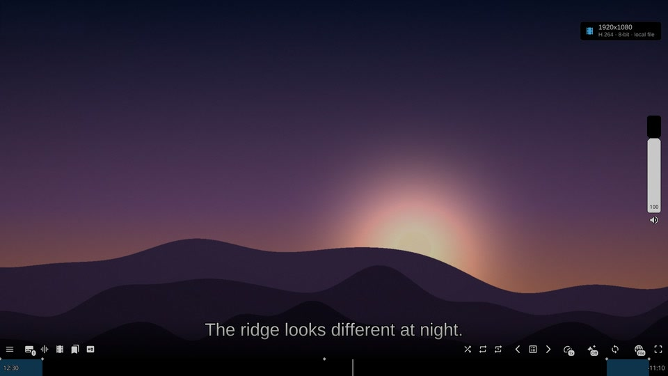
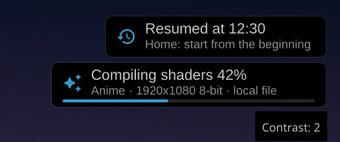
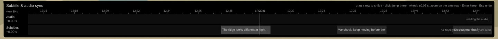
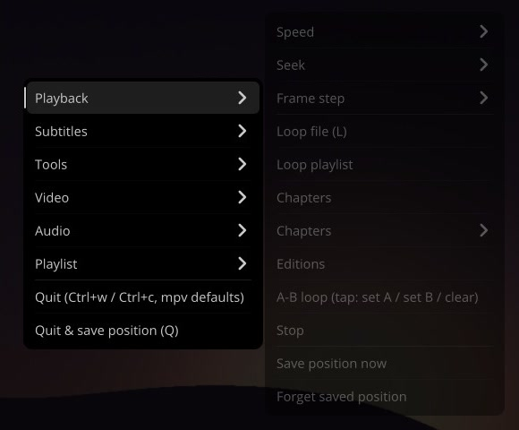

# mpv for Windows: anime and film setup

A portable [mpv](https://mpv.io/) setup for Windows. It has GPU upscaling
(Anime4K for anime, FSRCNNX + SSimSuperRes for films), shaders that compile in
the background before you need them, a timeline for fixing subtitle and audio
sync by eye, and a black, minimal [uosc](https://github.com/tomasklaen/uosc)
interface. Each choice was measured rather than guessed, and an automated test
suite checks every feature.



> **Tuned on one PC, set up for yours.** Everything was measured on a Radeon
> RX 9070 XT with a 1440p monitor on Windows 11. On your PC the player reads
> your screen and your memory, times the upscaling on your GPU, and shows you
> what it picked: press `F1`. Only that one PC has been tested so far, so
> [feedback from other PCs](#other-gpus-and-screens) helps a lot.

## Features

**Set up in the player**
- `F1` opens the **Welcome** menu: your settings at the top, with the
  recommended values marked, and then every feature with its key. It also
  opens by itself the first time you start mpv without a video.
- Right-click ▸ **Settings** has the same settings. Every option is listed,
  even when Auto picks one for you:
  - **Buffering**: FastStream's buffer settings, with its names and defaults:
    predownload the whole video, its maximum size, how much is kept in RAM
    before the rest goes on disk (or nowhere), and the seconds kept ahead and
    behind. Every number also takes 0, no limit, or any value you type.
  - **Start and stalls**: Adaptive (starts as soon as the download keeps up
    with the video, and waits longer only on a slower line), start at once,
    or wait until a few seconds are downloaded, before playing and after the
    stream runs dry (a stall). A seek never waits for it.
  - **Upscaling quality**: Auto, High or Fast, with the time each one took
    on your GPU.
  - **Screen for upscaling**, **Anime lines**, **Movie sharpness**, **HDR brightness**.
  - **Subtitle and audio language**.

**Upscaling you switch on, chosen by measurement**
- **Anime** (`Shift+A`): Anime4K's "Mode C+A": denoised, cleanly inked lines.
  On slower GPUs it uses Anime4K's own lighter "Fast" set (see
  [Other GPUs and screens](#other-gpus-and-screens)).
- **Movie** (`Shift+Y`): picks a chain by the real display scale. Below 2x
  it uses SSimSuperRes; at 2x and above, FSRCNNX + SSimSuperRes. Chroma is
  rebuilt from luma (CfL), and adaptive sharpening runs at an automatic
  strength.
- Both were picked by scoring against original clean footage (PSNR, SSIM,
  VMAF, edge sharpness and halo). The numbers, and the settings that lost and
  why, are in [`doc/history/`](doc/history/).
- Local files play without shaders until you pick a preset. Streams from
  FastStream (below) pick one automatically.

**Shaders compile before you need them**
- On start, mpv checks whether its shader cache matches the current driver,
  mpv build, shaders and config. If it doesn't, a second, hidden mpv draws
  every preset in every format in the background, with a small progress
  banner. Your video keeps playing and no frames are dropped.



**Subtitle and audio sync timeline** (`t`)
- Your subtitles and the audio's loudness are drawn on one timeline. Drag the
  subtitle row or the audio row until speech and text line up. `Enter` keeps
  the change, `Esc` undoes it.



**Interface**
- uosc with a soft control bar, Segoe UI and rounded corners, in OLED black.
  The Windows title bar is black too (Windows 11).
- Every message is a small banner top right. A resolution banner appears when
  a video starts.
- Subtitles move up above the controls while the controls are shown.
- Songs show "Artist – Title (feat. X)" in the window title, plus a details
  panel.
- A **source** button lists every link of the current file (stream URL,
  original page, local path) to copy or open.
- Right-click opens a menu with everything; see the screenshot below.

**Speed**
- Preset keys `r g b q w a y e h` (1x, 2x, 2.5x, 3x, 3.5x, 4x, 5x, 8x, 16x).
  Pressing the same key again goes back to the speed you had before.
  `s` / `d` change the speed by 0.1.
- The last speed is remembered across restarts, separately for videos and
  songs.

**One window for your files**
- A video or song you open from Explorer while mpv plays a local file goes
  into that window instead of a second one, like Windows Media Player. With
  several mpv windows open, the one you used last gets it. Files you select
  and open together become one playlist.
- A window playing a stream (from FastStream, a web link) is left alone: a
  local file then gets a window of its own.
- For a few seconds a banner top right offers **Play this in a new window**:
  one click puts the old file back, at the same second, and the new one
  plays on in a second window. Hold `Ctrl` while opening a file to get a new
  window straight away.

**Streams from the browser**
- Works with a [FastStream fork](https://github.com/Nawid3333/FastStream) for
  Firefox that hands browser videos to mpv. See
  [Use with FastStream](#use-with-faststream).

**Updates that are tested first**
- [`mpv-build.json`](mpv-build.json) pins one of [shinchiro's mpv builds](https://github.com/shinchiro/mpv-winbuild-cmake).
  A daily GitHub Actions job tries each new build against the test suite and,
  when all tests pass, offers it as one pull request (`mpv-update`) for the
  owner to merge. Nothing moves the pin by itself (since 2026-10-05).
- `updater.bat` brings the config up to date (`git pull` in a clone; in a
  one-click install it downloads what changed), installs the pinned build
  (checking every file's SHA-256) and updates yt-dlp.



## Install

### One click (recommended)

Open **PowerShell** (Start menu, type `PowerShell`, Enter), paste this line
and press Enter:

```powershell
irm https://raw.githubusercontent.com/Nawid3333/mpv-config/main/installer/setup.ps1 | iex
```

That line downloads the setup script and runs it (`irm` downloads, `iex`
runs). To read it first, open
[`installer/setup.ps1`](installer/setup.ps1). Or download this repository
(**Code ▸ Download ZIP**), extract it and double-click **`install.bat`**.
Either way it takes about a minute.

Everything is installed for your Windows account only, so no admin rights are
needed and nothing changes for other users of the PC. You don't need to
install Git or Node.js either. The setup:

1. checks the PC: 64-bit Windows 10 or 11 and a CPU with AVX2 (Intel from
   2013, AMD from 2015). It warns when it finds no Vulkan graphics driver
   (see [Other GPUs and screens](#other-gpus-and-screens));
2. installs this config into `%LOCALAPPDATA%\Programs\mpv`, plus mpv itself
   and yt-dlp (which mpv uses for web videos). Every download is checked
   against its known checksum, so a damaged or altered file is refused;
3. connects **FastStream**, the Firefox add-on that sends videos from the
   browser to mpv. A browser add-on cannot start programs by itself, so it
   needs a small helper program; the setup installs it, with its own private
   copy of Node.js (the runtime the helper is written for). Then it opens the
   signed FastStream add-on in Firefox: click **Add**;
4. adds mpv to the **Open with** list you get when you right-click a video or
   audio file (your default player is not changed), so that a file you open
   while mpv plays one goes into that window, and a Start menu folder
   **mpv** with *mpv*, *Update mpv* and *Uninstall mpv*.

When it is done, **restart Firefox** and switch FastStream's MPV mode on (see
[Use with FastStream](#use-with-faststream), step 4). The first video then
compiles the upscaling shaders in the background, with a small banner at the
top right.

- **Update:** Start menu ▸ mpv ▸ *Update mpv* (`updater.bat`). It updates the
  config, mpv, yt-dlp and the FastStream helper. Files you changed yourself
  are kept next to the new ones as `<name>.mine-<date>`.
- **Uninstall:** Start menu ▸ mpv ▸ *Uninstall mpv* (`uninstall.bat`). The
  FastStream add-on stays in Firefox; remove it in `about:addons`.
- **The keys do nothing?** Run `check-keys.bat` in the mpv folder while that
  mpv is open. It changes nothing; it asks every running mpv which config it
  read and what j, k, s, d, q, g and r do, and says whether that is this
  setup's keys, mpv's standard ones (and why), or a window focus problem.
- **Options:** another folder, or parts left out:
  `& ([scriptblock]::Create((irm https://raw.githubusercontent.com/Nawid3333/mpv-config/main/installer/setup.ps1))) -InstallDir D:\mpv -NoFastStream`
  (also `-NoFileTypes`, `-NoShortcuts`).

ffmpeg on `PATH` is optional; the sync tool uses it to read subtitle tracks
inside a video.

### With Git (to change the config yourself)

You need [Git](https://git-scm.com/) with Git LFS. PowerShell 7 is needed for
the tests and for `installer\warm-shader-cache.ps1`.

```powershell
# 1. Clone the repository AS the mpv folder (mpv runs in portable mode next to portable_config\).
#    Any folder works. Under Program Files this needs an admin prompt, and mpv needs write access:
git clone https://github.com/Nawid3333/mpv-config.git "C:\Program Files\mpv"
icacls "C:\Program Files\mpv" /grant "$($env:USERNAME):(OI)(CI)M"
cd "C:\Program Files\mpv"

# 2. Install mpv itself (the pinned build) and yt-dlp. Run this again later to update:
.\updater.bat

# 3. Optional: file associations, then one mpv window for the files you open
.\mpv-register.bat
.\mpv-single-register.bat
```

Play any video. The first time, a small banner top right shows the shaders
compiling in the background (under a minute, once per PC and again after
a driver update). Playback does not wait for it.

The full runbook (what each script does, troubleshooting, the commit guard) is
in [`RECREATE.md`](RECREATE.md).

## Use with FastStream

[Nawid3333/FastStream](https://github.com/Nawid3333/FastStream) is a Firefox
fork of FastStream that hands a video playing in the browser to mpv. This
config is built as its mpv side:

- **Upscaling picks itself.** The fork tags every stream as anime or movie
  (from your allowlist, see step 4). This config then applies Anime4K or the
  Movie chain automatically. Local files stay without shaders until you pick
  one.
- **Resume.** A stream continues where you stopped, even though its address
  changes on every visit. Saved positions last 7 days, and `Home` starts from
  the beginning.
- **Source button.** Shows the stream URL and the page it came from, ready to
  copy or to open in the browser.
- **One window.** The next episode replaces the current one in the same mpv
  window and starts playing. A pause or a subtitle delay from the previous
  episode does not carry over.
- **Episode buttons.** While FastStream plays a series in the window, the
  control bar has previous episode, next episode and an autoplay switch
  (`Shift+P`, `Shift+N` and `Ctrl+a` on the keyboard, and the keyboard's media
  keys for previous / next track).
- **Decoding.** Streams and local files both decode with `d3d11va-copy` on the
  graphics card's video engine. Vulkan decoding is off since 2026-10-04: it lost
  the graphics device on this AMD card.
- **Clear errors.** If a stream cannot be opened (for example, an expired
  link), a banner says to reload the page instead of showing an empty window.

### Setup (once)

The [one-click install](#one-click-recommended) does steps 1 to 3. After it
finishes, restart Firefox and continue with step 4.

1. **Install this config** as above. Without the one-click install, the
   fork's helper looks for `C:\Program Files\mpv\mpv.exe` first.
2. **Install the extension.** Download the signed `.xpi` from the fork's
   [Releases](https://github.com/Nawid3333/FastStream/releases) and open it in
   Firefox 142 or newer. Firefox then updates it by itself.
   Browsers built on Firefox (Zen, LibreWolf, Floorp) are not tested, and the
   one-click setup adds the add-on to Firefox only. Zen 1.22 and newer has a
   Windows bug that keeps add-ons from reaching programs on the PC
   ([zen-browser/desktop#15432](https://github.com/zen-browser/desktop/issues/15432)),
   so MPV mode may not work in Zen; use Firefox until Zen fixes it.
3. **Install the helper.** A browser extension cannot start programs by
   itself, so a small helper is registered once. It needs
   [Node.js](https://nodejs.org/) 22 or newer. Get the fork's source (Code ▸
   Download ZIP, or `git clone`), then in PowerShell:

   ```powershell
   cd FastStream\native-host
   powershell -ExecutionPolicy Bypass -File install.ps1
   # mpv somewhere else? add:  -MpvPath "D:\Apps\mpv\mpv.exe"
   ```

   Then **restart Firefox**. No admin rights are needed; it only writes to
   `%LOCALAPPDATA%\FastStreamMpvHost` and one registry key under `HKCU`.
4. **Turn it on.** In FastStream's settings, go to **MPV Mode**:
   - Tick **Open detected streams in mpv**.
   - Click **Test mpv connection**. It should say **mpv found**.
   - Add your sites to the **MPV Allowlist**, one per line. Sites count as
     movies; put `@anime` after the anime ones:

     ```
     https://movies.example.com
     https://anime.example.org @anime
     ```

### Use it

- Open a video on an allowlisted site, and mpv takes over.
- On any other site, use the player's **Open this stream in mpv** button. Right-click
  that button to set Anime or Movie for one video.

The fork's [MPV mode guide](https://github.com/Nawid3333/FastStream/blob/main/README-MPV.md)
has every option, troubleshooting (a helper log you can switch on) and how to
uninstall. Only the stream URL, the page address and three headers (`Referer`,
`Origin`, `User-Agent`) go to mpv. Cookies stay in the browser, so a stream
that needs a login session will not play in mpv.

## Keys

| Key | Action |
|---|---|
| Click / double-click / right-click | Play-pause / fullscreen / menu |
| `Shift+A`, `Shift+Y` | Anime upscaling on/off, Movie upscaling on/off |
| `Shift+S` | The next choice of what runs: Anime's lines (Crisp / As drawn) or Movie's sharpness (Auto, Off, Low, Medium, High) |
| `t` | Subtitle and audio sync timeline |
| `c` | Subtitles on/off (selects a track if none is chosen) |
| `r g b q w a y e h` | Speed 1x, 2x, 2.5x, 3x, 3.5x, 4x, 5x, 8x, 16x (again: back) |
| `s` / `d` | Speed -0.1 / +0.1 |
| `←` `→` / `j` `k` / `z` `x` | Seek 5 s / 10 s / 60 s |
| `0`-`9` | Jump to 0 %-90 % |
| `Shift+N` / `Shift+P`, media keys | Next / previous episode: of a FastStream series (the page goes on, this window plays it), or the next / previous file of a local file's folder. `n` is next too |
| `Ctrl+a` | FastStream's autoplay of the next episode on/off |
| `↑` `↓`, wheel, `m` | Volume ±10, ±2, mute |
| `i`, `I` | Stats |
| `F1` | Welcome menu: settings and every feature |
| `f` / `Esc` | Fullscreen / leave fullscreen |
| `PgUp` / `PgDn` | Next / previous chapter |
| `Ctrl+s` | Screenshot of the window as you see it |
| `Ctrl+v` | Play a copied link |
| Media keys | Play/pause, stop (quits), forward / back 60 s, volume, mute |
| `Ctrl+q` | Quit and save the position (`Ctrl+w`, `Alt+F4` or the window's X quit) |

These are all the keys: mpv's own default keys are switched off, so a key does only what
this table says. What mpv's other keys did (zoom, rotate, track and delay steps, ...) is in
the right-click menu. Every key and menu entry is in [`input.conf`](portable_config/input.conf).

## Settings

Open them with the **gear button** in the control bar, right-click ▸
**Settings**, or `F1` (the Welcome menu shows the same settings above the
feature tour). Every submenu starts with a short note on what the setting
does, and each option shows its pro or con. Choices apply at once and are
stored per PC (in `portable_config\settings.json` and `upscale.json`, never in
git).

| Setting | What it does | A new install starts with | Options: pros and cons |
|---|---|---|---|
| **Buffering ▸ Predownload the whole video** | Downloads the entire stream in the background, up to the maximum size. | On | On: no stalls once loaded, seeking anywhere is instant. Off: only the seconds ahead |
| **Buffering ▸ Maximum size of predownloaded video** | The most a predownload takes (never more than 60 % of the free disk space). | 5 GB | 0: nothing predownloaded, only the seconds ahead. No limit: the whole video, however big. Or type any size |
| **Buffering ▸ RAM for buffered video** | How much of the video is kept in RAM; beyond it the rest goes on disk (or, with the disk off, nothing more is kept). | Auto: by your memory (under 6 GB: 150 MB, under 12 GB: 512 MB, under 16 GB: 1 GB, else 2 GB) | 0: nothing in RAM (all on disk; with the disk off nothing is kept and videos may stop to load). No limit: all in RAM, none on disk; other programs may slow down on a PC with little memory |
| **Buffering ▸ Keep video on disk when that RAM is full** | Beyond the RAM above, the stream goes into a temp file (deleted when the video closes). | On | Off: nothing is written to the disk; the buffer stops at the RAM above |
| **Buffering ▸ Seconds ahead** | Kept ahead of playback when predownload is off, has stopped or ran out of space. | 300 s | 0: nothing ahead, the video stops to load often. No limit: the whole video, even with predownload off |
| **Buffering ▸ Seconds behind** | Kept behind playback while the whole video is not predownloaded (a predownload keeps everything). | 20 s | 0: seeking back loads it again. No limit: everything played is kept |
| **Start and stalls** | Waits for some seconds of video before playing, and again after the stream ran dry. A seek plays at once. | Adaptive | Adaptive: measures the line while it waits; a line that keeps up with the video starts after 1 s of buffer; a slower one waits at most 3 s before the first frame, and after a stall buffers for about half a minute of play (at most 10 s): the same total wait in fewer pauses; the menu shows what it measured. Start at once: fastest start, may stall early. 3 s: a fixed wait. 5 s: smoother on a slow line. 10 s: longest wait, fewest stalls |
| **Upscaling quality** | How much GPU time the upscaling may take. | Auto: measured on your GPU (High if it fits, else Fast, else off) | High: sharpest, most GPU time. Fast: about half the time, a bit softer. Each shows the time it took on your GPU; a choice here always runs |
| **Screen for upscaling** | The screen size the upscaling plans for: which Movie chain runs, how much it sharpens. | Auto: the screen mpv is on | 1920x1080, 2560x1440, 3440x1440, 3840x2160 - only for when mpv reads the screen wrong |
| **Anime lines** | How anime upscaling treats line art: Anime4K's Restore step redraws lines crisper and thinner. | Crisp | Crisp: clean, thin lines; right for blurry sources. As drawn: without Restore, the show's own line weight (for one whose lines look too thin) |
| **Movie sharpness** | Extra crispness for films after upscaling (it looks sharper; it adds no detail). | Auto: more for bigger enlargements | Off: softest, closest to the source. Low, Medium. High: crispest, may look harsh |
| **HDR brightness** | For HDR videos only: your screen's peak brightness, from its spec sheet. Set per screen. | Auto: the screen's own value | 300 to 1000 nits. Too high: bright parts clip. Too low: HDR looks dimmer than it could |
| **Subtitle language** | The subtitle track picked when a video starts: the first of these languages the file has. | Automatic: your Windows language | English, German, French, Japanese and more, each then English |
| **Audio language** | The audio track picked when a video starts. | Automatic: the file's default track | The same list |

A PC that ran this config before the settings existed keeps its earlier values
(German, then English; 350 nits; 1 GB; 3 s).

**A new monitor** (4K, another refresh rate, HDR): the screen is read from
Windows. The first time mpv runs on a new screen, a banner says so ("New
screen: 3840x2160 @ 120 Hz - F1: check its settings"). The upscaling and the
background shader compile follow the new size by themselves. HDR brightness
is kept per screen and starts at Auto on a new one, so two monitors each keep
their own value. The Settings menu's first line shows the screen mpv is on.

## Buttons

The control bar at the bottom (move the mouse to show it):

| Button | Click | Right-click |
|---|---|---|
| ☰ menu | the menu with everything (same as right-clicking the video) | |
| subtitles, audio, video | pick a track | |
| ▶ / ⏸, previous, playlist, next, shuffle, loop | as their icons say | |
| **speed** (the badge shows it) | next speed step | speed menu |
| **upscale** ✨ (badge: Off / Anim / Movi) | next upscaler: Off, (Auto), Anime, Movie | upscale menu: quality, sharpness, rebuild shaders |
| **sync** | the subtitle and audio sync timeline (`t`) | |
| **source** 🌐 (badge: File / Fast / Strm) | every link of the file: stream, original page, local path, to copy or open | the same |
| **settings** ⚙ | Settings | Welcome menu and every feature (`F1`) |
| fullscreen | fullscreen on / off (also double-click) | |

Decoding is fixed: everything decodes with `d3d11va-copy` on the graphics
card's video engine. Vulkan decoding dropped frames on long local files with
an AMD driver (2026-09-16) and lost the graphics device on streams with the
October 2026 builds (2026-10-04). `mpv.conf` explains it, and the static tests
refuse a vulkan or auto `hwdec`.

## Other GPUs and screens

**Screens.** The upscaling picks its chain from the real scale between the
video and your screen, so a 1080p or 4K screen gets the right one by itself:

| Video | 1080p screen | 1440p screen | 4K screen |
|---|---|---|---|
| 480p | 2.25x | 3x | 4.5x |
| 720p | 1.5x | 2x | 3x |
| 1080p | 1x (no upscaling) | 1.33x | 2x |
| 4K | 0.5x (downscaled) | 0.67x | 1x |

Movie uses SSimSuperRes below 2x and FSRCNNX + SSimSuperRes from 2x on.
Anime4K's own stages follow the scale too. The quality was compared at 1.33x,
1.5x, 2x and 3x, which covers every cell above except 480p on a 4K screen.
The background shader compile adds clip sizes for any scale your screen
reaches that the standard sizes miss, and runs again when you change screens.

**GPUs.** Every GPU computes the same picture; only the speed differs. So the
first time a chain runs, Auto reads its time from the GPU's own timers. If it
needs more than half of a frame's time, Auto switches to Anime4K's lighter
"Fast" set (or Movie without FSRCNNX) and tells you with the number.
**Settings ▸ Upscaling quality** shows what was measured, and you can still
pick High. Measured on two GPUs (GPU time per frame; a 24 fps video has
41.7 ms per frame, and Auto wants a chain to fit in half of it):

| Anime on a 1440p screen | 1080p video | 720p video | 480p video |
|---|---|---|---|
| RX 9070 XT, High / Fast | 3.5 / 1.5 ms | 2.0 / 0.9 ms | 1.1 / 0.6 ms |
| Ryzen 5 7600X built-in graphics, High / Fast | 196 / 75 ms | 115 / 52 ms | 48 / 24 ms |

On the RX 9070 XT, Auto keeps High everywhere. On the built-in graphics even
Fast needs more than half a frame (20.8 ms at 24 fps; 24 ms for the 480p
video), so Auto turns upscaling off for that screen and those video sizes and
says so. Settings ▸ Upscaling quality can still run High or Fast there.

**Requirements:** Windows 10 or 11 (64-bit) and a CPU with AVX2 (Intel from
2013, AMD from 2015). The picture is drawn with Vulkan; a PC without a working
Vulkan driver falls back to Direct3D 11, where the first use of each
upscaler compiles slowly.

**Please tell us how it runs.** Open an
[issue](https://github.com/Nawid3333/mpv-config/issues) with:
- your GPU and your screen resolution;
- what **Settings ▸ Upscaling quality** shows (Auto's pick and the
  milliseconds);
- whether anything stutters (press `i` for the stats).

## Tests

```powershell
pwsh tests/run-tests.ps1             # static + headless, ~1 min, no window
pwsh tests/run-tests.ps1 -Tier gpu   # the real renderer, fullscreen, ~5 min (close mpv first)
```

The headless tier runs a copy of mpv on a copy of the config, so your
settings, history and shader cache are never touched. It drives mpv with its
own input commands and checks that the banners are really drawn. CI runs
static + headless on every push. See [`tests/README.md`](tests/README.md).

## For contributors and AI agents

[`AGENTS.md`](AGENTS.md) is the short handoff: how the parts fit together,
the rules for changing them and the decisions not to undo.
[`doc/history/`](doc/history/) has the detailed notes behind them: what was
measured, what was tried and rejected, and why.

This repository is where the setup is developed: every change comes as a pull
request that has passed the tests. Until 2026-10-21 it was a published copy of
a private workspace, and commit hashes and pull request numbers in the notes
up to that day refer to the workspace. Issues and pull requests are welcome.

## License

MIT for the files written for this repository ([`LICENSE`](LICENSE)). Bundled
third-party files (uosc, thumbfast, the shaders, 7-Zip and others) keep their
own licenses; see [`THIRD-PARTY-NOTICES.md`](THIRD-PARTY-NOTICES.md).
